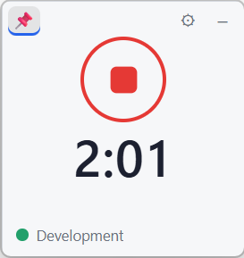
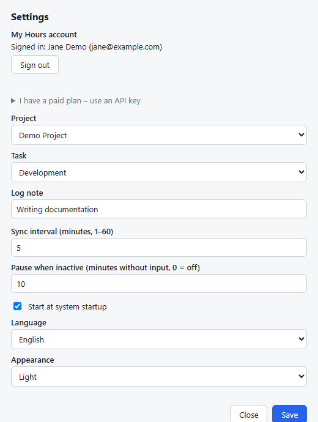

# Hours.Tickr

A small desktop app (Windows + macOS, built with [Tauri 2](https://tauri.app) and Rust) that tracks how long you work on your computer and syncs the time to [My Hours](https://app.myhours.com). Each continuous tracking run is saved as one time log.

## Screenshots

| Timer | Settings |
|:---:|:---:|
|  |  |

## Installation and running

Requirements: Node.js LTS, [Rust](https://rustup.rs) (stable), and on Windows the MSVC C++ Build Tools including the Windows SDK (workload "Desktop development with C++") and WebView2 (included in Windows 11).

```
npm install
npm start          # run the app (tauri dev)
npm test           # logic unit tests (cargo test)
npm run lint       # ESLint for the UI + cargo clippy
npm run dist:win   # NSIS installer (src-tauri/target/release/bundle/nsis/)
npm run dist:mac   # dmg (must be built on macOS)
npm run icons      # regenerates the icons in assets/
```

Installers for Windows and macOS are also built by GitHub Actions (`.github/workflows/build.yml`).

After the first run, the packaged app adds itself to the system's startup programs. You can turn this off in the settings or from the tray icon menu. Running from `npm start` does not set up auto-start.

## Signing in to My Hours

Hours.Tickr supports two sign-in methods. Only one is active at a time; saving one replaces the other.

### 1. My Hours account (recommended, also works on the free plan)

1. Open Settings (⚙ icon) and click **Sign in to My Hours**.
2. In the window that opens, sign in as you would on the web app (email and password, or Google). The sign-in cookies stay in a separate profile for that window, so next time one click is usually enough.
3. After signing in, select a **project** (and optionally a task) and click **Save**.

The app never sees your password, does not type anything into the My Hours page, and does not read it. Only a refresh token is stored, in the system credential store (Windows Credential Manager / macOS Keychain); the access token is kept in memory only. **Sign out** revokes the token, deletes it, and clears the sign-in window's data.

**Warning: this is an unofficial method.** Hours.Tickr uses the same sign-in as the My Hours web app (OpenID Connect, Authorization Code + PKCE, the web app's `client_id`), because the official API key is only available on paid plans. My Hours may change this at any time, in which case it stops working and the app needs to be updated.

If Google refuses the sign-in inside the window ("insecure browser"), sign in with your My Hours email and password instead (for an account that was created with Google, first set a password for it in My Hours). If the sign-in expires, the app shows "Sign-in expired – please sign in again"; tracking is stored locally and uploaded after you sign in again.

### 2. API key (paid plan)

1. Sign in at https://app.myhours.com and, in your profile settings under **API**, create an **API key**.
2. In Settings, expand "I have a paid plan – use an API key", paste the key, and click **Verify**. A valid key is saved.
3. Select a project and click **Save**.

The key is stored in the system credential store. The window never shows the full key again (only `••••1234`), and it is never written to the log.

**Upgrading from an older version:** `state.json` and `settings.json` are copied automatically from the old location on the first run. A saved sign-in is not carried over, so after updating you just need to sign in once more.

Without a sign-in and a project, the window shows "Set up My Hours" and tracking cannot be started.

## Controls

- **Round button** (or Space / Enter): Start / Stop. Stopped = green "play" arrow, running = red stop square, paused = dimmed red stop square with the "Paused" text. Below it is today's tracked time in `H:MM` format.
- **📌** always on top (remembered), **⚙** settings, **–** hide to the notification area. The window can be dragged, and its position is remembered.
- Closing the window does not quit the app; it keeps running in the tray. To quit: tray menu → **Quit**.
- Tray menu: Start / Stop, Show window, Always on top, Settings…, Sync now, Start at system startup, Quit.

## Language and appearance

Two options in Settings take effect immediately (no restart and no need to click Save):

- **Language**: System default (default) / Čeština / English. "System default" uses the first preferred language of the system (Czech and Slovak map to Czech, anything else to English). Both windows, the tray menu, the tooltip and the window titles are switched. Logs are always in English.
- **Appearance**: System default (default) / Light / Dark.

All texts are in the dictionaries `locales/cs.json` and `locales/en.json`.

## Behaviour on lock, sleep and shutdown

Tracking has three states: **stopped**, **running** and **paused**. Only you decide whether tracking should run (Start / Stop).

- **Screen lock or sleep**: the current run is closed and tracking is paused. After unlocking (or waking up without a lock screen), a new run is opened automatically.
- **Shutdown / sign-out of the computer**: the run is closed and the state is saved to disk. After the next start of the computer and the app, tracking continues in a new run.
- **Quitting the app** (Quit): the run is closed; on the next launch tracking resumes if it was running.
- **App crash or power loss**: a "heartbeat" is written every 30 s. An unclosed run is closed at the time of the last heartbeat on the next start.
- **Midnight**: a running run is split into 23:59:59.999 and 00:00 (logs are counted per day).
- Changing the project, task or note during tracking closes the run and opens a new one with the new values.

## Synchronization

Operations (start / stop / inserting a finished log) are placed in a persistent queue and sent in order. When the network is down, the queue is saved to disk and sent later; a start and a stop that were not sent yet are merged into one `insertlog`. Runs shorter than 60 s are not sent if their start has not been sent yet. Temporary errors (network, 5xx, 408, 429) are retried with a delay of 30 s to 5 min. Syncing also runs on every state change, at startup, and periodically (5 minutes by default, configurable from 1 to 60). An invalid API key (401/403) stops retries until the key is changed. Other 4xx errors are permanent: the operation is marked as failed, written to the log, and a warning is shown.

A colored dot next to the project name shows the sync status (the tooltip describes it).

## Where data and logs are stored

User data folder: `%APPDATA%\cz.hourstickr.tracker` (Windows), `~/Library/Application Support/cz.hourstickr.tracker` (macOS).

| File | Contents |
|---|---|
| `state.json` | tracking state, runs (7 days), sync queue |
| `settings.json` | project, task, note, interval, language, appearance, window position |
| `logs/hours-tickr.log` | log (rotated at 1 MB, one old file kept as `.log.1`) |

The sign-in data (refresh token or API key) is in the system credential store under the service name "Hours.Tickr", not in a file.
## Project structure

- `src-tauri/core/` crate `hours-tickr-core`: pure logic without Tauri (`tracker`, `sync_queue`, `api`, `auth`, `secrets`, `power`, `idle_watcher`, `store`, `model`, `i18n`) and its tests
- `src-tauri/src/` the application: `app.rs` (wiring), `ui.rs` (windows and tray), `commands.rs` (IPC), `platform/` (idle, screen lock and power events for Windows and macOS)
- `ui/` the timer and settings windows (HTML/CSS/JS) and `tauri-bridge.js`
- `locales/` text dictionaries (cs/en), shared by Rust and the UI
- `assets/` icons and the `generate-icons.js` script
- `docs/SPEC.md` behaviour specification, `docs/ARCHITECTURE.md` architecture and code rules
- `docs/screenshots/` screenshots used in this README

## Known limitations

- The `startNewLog` and `tasklist` responses of My Hours are not fully documented and are parsed defensively (see `src-tauri/core/src/api.rs`). The format of the `date` field (currently `YYYY-MM-DD`) is defined in one place, in case the API starts returning 400.
- **macOS:** the code for screen lock and idle detection was written without access to a Mac and is only checked by a CI compile. Screen lock is detected by polling once per second, sleep is detected from the time gap between ticks, and shutdown/sign-out by the app quitting. Test it on a real Mac before deploying.
- The installer is not signed, so Windows SmartScreen (and Gatekeeper on macOS) shows a warning on the first run.

## One record per day

Multiple starts and stops of the timer (including screen locks) are merged into **one My Hours record per day** for the same project, task and note. Each new start of the app creates a new running record with the matching offset, and the old stopped one is deleted. Records created by an older version stay unchanged.

## Inactivity

When neither the mouse nor the keyboard is used for a while (10 minutes by default, configurable in the settings, 0 = off), tracking is paused. The inactive time is **not** counted (the run is closed at the moment of the last movement), and tracking resumes automatically after the next movement. Note: watching a video or reading without any input counts as inactivity.
